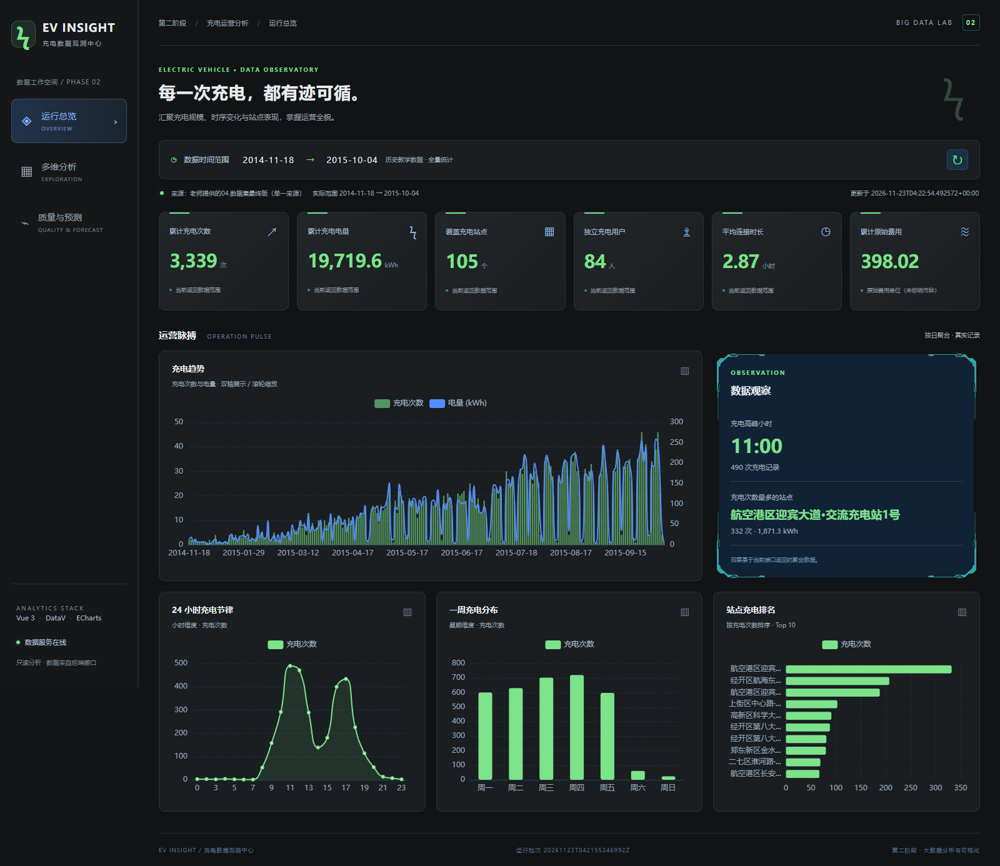
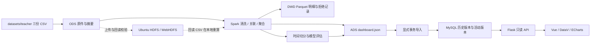

# 电动汽车充电桩大数据分析与可视化平台

面向课程提供的三份历史 CSV，完成可追溯的数据清洗、多维统计、日级电量预测和 Web 展示。Spark 生成分析快照，经事务导入 MySQL 后，由 Flask 向 Vue 大屏提供统一版本的数据。

这是第 7 组第二阶段课程项目。工程价值在于数据口径核对、结果发布一致性及完整复现链路，不将历史教学实验表述为生产系统或科研创新。

## 效果与结果



另见[多维分析](frontend/screenshots/current-analysis.png)和[质量与预测](frontend/screenshots/current-quality.png)。新图展示当前有效订单口径；截图的实际数据链路及本轮复测范围见[验证记录](docs/VALIDATION.md)。历史 `live-*.png` 采用旧口径，仍作为历史证据保留。

三份输入覆盖 **2014-11-18 至 2015-10-04**。[保存基线](results/reference/dashboard.json)批次 `20260917T072007238833Z` 的真实结果如下。

| 指标 | 清洗后结果 |
|---|---:|
| 原始会话 / 有效订单 / 隔离会话 | 3,395 / 3,339 / 56 |
| 有效订单记录电量 | 19,719.59 kWh |
| 费用合计 | 398.02，原文件未标明币种 |
| 有效订单覆盖用户 / 站点 | 84 / 105 |
| 有效电池采样 / 隔离电池采样 | 0 / 1,594 |

电池负电流按课程规则隔离，原始记录与拒绝原因均保留。数据语义、年份解释和教学时段的边界见[数据说明](datasets/README.md)。

## 已实现功能

- **数据处理**：CSV 原件及 SHA-256 留存，日期交叉核验，会话/站点/电池规则校验，拒绝记录独立落盘；十个分析维度与两组交叉比较核对同一有效订单总体。
- **预测评估**：同星期基线、线性回归、随机森林；按时间划分训练/验证/测试，按验证集 RMSE 选模型，保存全部测试成绩及重训模型。
- **结果发布**：MySQL 保留历史版本；结果、图表与活动版本切换在同一事务中提交，失败回滚；Flask 用一致性读取事务取得快照。
- **展示**：Vue 3、DataV 与 ECharts 三页大屏，指标切换、错误重试、空数据状态和窄屏布局。
- **可选验证链**：经 WebHDFS 上传、回读、校验并重算。HDFS 负责存储，默认 `local[2]` Spark 负责本地计算。

## 架构与代码



| 位置 | 职责 |
|---|---|
| `datasets/teacher/` | 三份输入与校验值 |
| `jobs/cleaning.py`、`pipeline.py` | 清洗规则、十维分析、分层输出 |
| `jobs/forecast.py`、`runtime.py` | 预测与 Spark 环境 |
| `api/` | MySQL 初始化、版本导入、四个 GET 接口 |
| `frontend/` | Vue 大屏、锁定依赖与浏览器测试 |
| `deploy/` | 可选 HDFS 存储与回读工具 |
| `results/reference/` | 最终基线快照、模型与摘要 |
| `tests/`、`docs/` | 自动化验收与技术文档 |
| `data/`、`runtime/` | 本地生成结果及运行状态 |

技术栈以 [Python 依赖](requirements.txt)和[前端锁文件](frontend/package-lock.json)为准。原开发基线为 Windows、Python 3.13、JDK 17、MySQL 8.0.30；前端要求 Node.js ≥23。PySpark 4.2.0、Flask 3.1.3、Vue 3.5.21、ECharts 5.6.0 来自现有锁定声明，本次不升级依赖。Windows Spark 的 Python/Java 路径宜使用 ASCII；Linux 差异见完整指南。

## 快速运行：使用真实保存结果

以下为 Windows PowerShell 示例。克隆到 ASCII 路径，并按本机安装位置配置 MySQL 8.0。此路径展示保存结果，不重新训练模型。

```powershell
git clone -c core.longpaths=true https://github.com/dthu7b8a-design/bigdata.git C:\ev-insight
Set-Location C:\ev-insight
py -3.13 -m venv .venv
$python = (Resolve-Path .venv\Scripts\python.exe).Path
& $python -m pip install -r requirements.lock.txt
Push-Location frontend
npm ci
npm run build
Pop-Location
```

首次新建独立 MySQL 时，确保 `127.0.0.1:3307` 空闲、`api/.env` 尚不存在，再执行：

```powershell
$env:MYSQL_BASEDIR = 'C:\MySQL\mysql-8.0.30-winx64' # 改成本机含 bin\mysqld.exe 的目录
& $python -m api.bootstrap_mysql
& $python -m api.import_results results/reference/dashboard.json
& $python -m api.run
```

初始化工具创建项目独立实例与随机凭据，仅写本地忽略的 `api/.env`，不修改既有 3306 实例。不要复制其他机器的凭据或数据库目录。已有专用实例、Linux 配置、重启及常见问题见[完整指南](docs/REPRODUCIBILITY.md)。

浏览器打开 `http://127.0.0.1:5000/`。另一终端用 `Invoke-RestMethod http://127.0.0.1:5000/api/health` 检查 ready=true。四个只读接口为 `/api/health`、`/api/dashboard`、`/api/quality`、`/api/model`；结果接口拒绝日期及未知查询参数。刷新只读取已发布快照，不会重新训练。

## 完整复现与测试

从项目根目录运行三 CSV 清洗、分析、训练，再发布新结果：

```powershell
$env:JAVA_HOME = 'C:\Java\jdk-17' # 改成本机 JDK 17 安装根目录
$env:BIGDATA_PYTHON_HOME = (Resolve-Path .venv).Path
& $python -m jobs.pipeline --source datasets/teacher --output data
& $python -m pytest -q
& $python -m api.import_results data/ads/dashboard.json
Push-Location frontend
npx playwright install chromium
npm run test:e2e
Pop-Location
```

Python 测试包含独立 CSV 对账和 Spark 清洗边界；真实 MySQL 用例默认跳过。浏览器测试读取完整 ADS，真实 Flask 用例在 5000 未就绪时跳过。按[指南](docs/REPRODUCIBILITY.md#测试层次)显式启用数据库测试并保持 Flask 在线，检查实际通过/失败/跳过，不能将命令成功解释为全部外部服务已验证。本轮实际执行范围见[验证记录](docs/VALIDATION.md)。

## 预测结果与适用范围

下表来自保存基线，单位为日级记录电量的 kWh；划分为 219 天训练、47 天验证、48 天测试。

| 方法 | 测试 MAE | 测试 RMSE | 测试 R² |
|---|---:|---:|---:|
| 同星期历史基线 | 32.622 | 47.650 | 0.7122 |
| 线性回归 | 33.771 | 45.147 | 0.7417 |
| 随机森林 | 75.476 | 88.449 | 0.0085 |

线性回归按验证集 RMSE 被选中，但测试 MAE 未优于基线；随机森林也未优于基线。测试使用此前已观测到的真实滞后量，属于滚动单步评估，不能解释为一次预测完整未来区间。历史次日 `2015-10-05` 的预测约 165.37 kWh，不代表当前运营需求。

## 团队与个人贡献

| 成员 | 课程项目主责 |
|---|---|
| 李石屹 | 组长；架构与集成、Flask/MySQL 发布、HDFS 回读、服务脚本与后端验收 |
| 魏明德 | Spark 数据清洗、多维分析与运行环境复核 |
| 王耔樾 | 时序特征、模型训练评估、独立数据核对 |
| 李博文 | Vue/DataV 大屏、图表与浏览器测试 |

以上依据团队分工及个人总结，说明负责复核、完善、维护和验收的范围；不以责任划分替代逐提交作者证明，不声称全部代码由某一成员独立原创。

## 文档与限制

- [完整复现指南](docs/REPRODUCIBILITY.md)：环境、数据、MySQL、测试、HDFS 和排错。
- [个人技术档案](docs/PROJECT_TECHNICAL_GUIDE.md)：原理、代码导读、面试准备与研究方向。
- [数据与校验](datasets/README.md) · [成果与来源](docs/ARTIFACTS.md)。
- [本轮验证记录](docs/VALIDATION.md) · [整理报告](docs/PROJECT_CLEANUP_REPORT.md)。

外部采集来源、费用币种和部分字段语义未获证实；电池时间精度不足且有效采样为空，不构造连续电池曲线。HDFS 是可选存储链，本地 Spark 不是 YARN 集群。依赖安全审计及跨平台未验证范围见验证记录，不能将锁定版本等同于没有已知漏洞。后续可研究滚动验证、缺失日期敏感性、基线对比及跨站点泛化。
